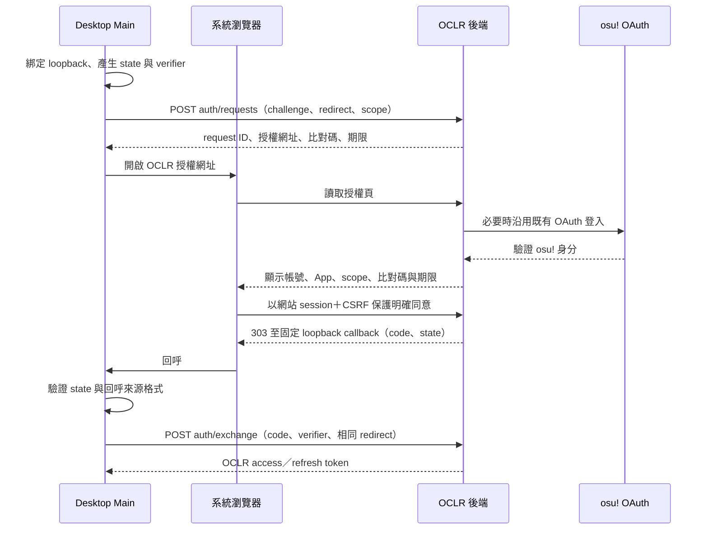

# OCLR 桌面授權資料契約

- 契約草案：1.0.0（尚未發布）；文件版本：0.4；日期：2026-10-27
- 狀態：M0 本機 callback 已部分驗證；待聯合審閱與實作，沒有建立正式授權端點
- 使用者代理：OCLR-ref-tools 桌面 Main process 與系統瀏覽器
- HTTPS 基底：`https://oclr.org`；桌面 API 前綴：`/api/desktop/v1`

## 1. 目的及既有系統邊界

沿用 OCLR 既有 osu! OAuth `identify` 登入，新增第一方桌面授權交換。osu! client_secret、上游 code 與上游 token 均留在 OCLR 後端。App 收到的是 OCLR 桌面憑證，不能用於 osu! IRC 或直接呼叫 osu! API。

這是一份採用外部瀏覽器、一次性授權碼與 S256 證明的第一方協定提案，JSON endpoints 不是通用 OAuth authorization server。PKCE 由 OCLR 桌面交換層實作，不表示現有 osu! OAuth 已支援同樣流程。

現有 `/auth/osu` 與 `/auth/osu/callback` 可沿用；現有回呼固定回到 dashboard，需新增由伺服器保存、僅允許返回指定桌面授權頁的登入延續資訊。不得接受任意 return URL，也不得把桌面 code 轉交 osu!。

## 2. 授權模型與預設值

M0 已驗證 macOS 本機 HTTP origin 的系統瀏覽器 form POST→303→loopback，以及錯 state／重放拒絕；尚未驗證正式 HTTPS 起點、CSRF、osu! OAuth、其他平台或真實 token 端點。見 [SPIKE 結果](../m0/spike-results.md)。

D02／D03 已由使用者確認，見 [設計決策](../design-review.md)。以下作為 MVP 授權基線；端點仍待前後端技術驗證與聯合定版，不代表已部署：

| 項目 | 契約 |
| --- | --- |
| 公開 client ID | `oclr-ref-tools`；僅是識別字，不能當作可信 App 證明 |
| 可授權 scope | `referee:fixtures:read`、`referee:context:read`；MVP 要求兩者，無法取得時整筆拒絕 |
| 授權資格 | 有效 OCLR 帳號，且至少一項目前有效的 Referee／Admin 裁判能力 |
| 資源限制 | 每次存取再檢查本人指派與有效能力；Admin 在桌面 API 也只讀本人指派場次 |
| 授權交易 | 10 分鐘，伺服器維護 pending／approved／exchanged／denied／expired |
| 交換碼 | 256-bit 隨機值、單次使用；最長 60 秒且不超過交易期限 |
| state | App 產生 256-bit 隨機值；每次登入交易不同，只存當次記憶體 |
| code verifier | 依 RFC 7636，43–128 個允許字元；建議以 32 隨機位元組產生 |
| code challenge | `BASE64URL(SHA256(ASCII(code_verifier)))`，不含 padding；只接受 S256 |
| access token | opaque、256-bit；提議前綴 `oclr_desk_at_`，有效 10 分鐘 |
| refresh token | opaque、256-bit；提議前綴 `oclr_desk_rt_`；每次 refresh 輪替 |
| desktop session | 固定最長 12 小時；2 小時未成功 refresh 則過期，輪替不延長絕對期限 |
| P0 保存 | App 僅於 Main 記憶體保存 access／refresh token；重啟需再授權 |
| 同時 session | 每帳號最多 5 個未撤銷且有效 session；超過時回傳明確錯誤，不暗中踢出舊裝置 |

網站 session 用於當次授權確認；已發行的 desktop session 獨立存在。網站登出不會自動撤銷它，授權頁必須明示期限與撤銷入口。角色撤銷、停權、桌面 session 撤銷仍於下一個 API 請求生效。這是 D02 已確認的產品行為，與既有 Developer token 綁定網站 session 的行為不同。

「2 小時閒置」是協定上未 refresh 的時間，不是使用者兩小時未操作滑鼠；背景正常更新仍保持 session 至絕對期限。任何資源請求也必須檢查 session 的閒置與絕對期限。只失去某 edition 能力時，該 edition 資源失效，其他仍有權的場次不因此失效；失去全部裁判資格或停權時，撤銷 session family。

不授予 Developer、Admin 管理、賽果發布或任意私人資料讀取能力。P1 寫入 scope 需另立契約及授權頁，不預先發放。

## 3. 完整流程與信任邊界



系統瀏覽器處理網站 cookie 與 osu! 登入；桌面不匯入 cookie、不讀取瀏覽器密碼。App 只開啟本機固定設定的 OCLR HTTPS origin，不接受 API 回應將授權導向其他 origin。

### 3.1 Loopback 回呼

- App 先綁定 `127.0.0.1` 的可用高位 port，再建立授權交易，避免登錄未持有的 port。
- 唯一允許的 redirect 格式為 `http://127.0.0.1:{port}/oclr/callback`，port 為 1024–65535。
- 禁止 localhost、其他 IP、IPv6、userinfo、query、fragment、不同 path 與任意遠端 redirect。P1 另評估 IPv6／自訂協定。
- 後端只解析與比對 URI，不向 loopback 發出伺服器 HTTP 請求；exchange 時逐字比對已接受的正規形式。
- listener 只接受正確 Host、GET、當次 state、單一 code 或 error；拒絕重複參數與超長輸入。
- 收到錯誤 state 不關閉合法交易；正確回呼只接收一次。使用者取消或逾時則停止 listener。
- osu! OAuth 使用自己的上游 state；桌面 state 只關聯 loopback 交易，兩者不可重用。每次 callback 與交換都綁定當次登入 generation，登出或重啟登入後忽略舊 callback。
- 回呼頁為無外部資源的靜態結果，不回顯 code／state，使用 no-store、no-referrer；關閉 access log 中的 query 記錄。

瀏覽器回呼 URL 可攜帶短效 code 及 state，access／refresh token 不得出現在任何 URL。S256 降低 code 被攔截後遭兌換的風險，但不能取代 token 的保密。

## 4. 共通 HTTP 與資料規則

- 桌面端 JSON 請求使用 `Content-Type: application/json`、`Accept: application/json`，不帶網站 cookie。
- 回應使用 `Cache-Control: no-store`、`X-Request-Id`、`X-OCLR-Desktop-Contract: 1.0.0`。
- 版本相容性採與 context 契約相同的 major／minor 規則；支援同 major 的新增回應欄位，未知必要語意停用整合，不改抓 Developer／cookie 端點。
- 成功 envelope 為 `{ data, meta: { apiVersion: "1", contractVersion: "1.0.0", requestId, serverTime } }`。
- 錯誤 envelope 為 `{ error: { code, message, requestId, retryable } }`；message 僅供顯示，客戶端依 code 分支。
- 所有時間為 RFC 3339 UTC；serverTime 是時間依據。JSON body 上限 8 KiB；未知欄位、重複欄位及未知 scope 回 400。
- Main 直接以 HTTPS 呼叫；不需要為 Renderer 開放跨域權限。瀏覽器管理接口只接受網站同源 cookie＋CSRF，Bearer 不能替代。
- 外部端點不存在、回傳 HTML 或缺少可驗證的契約時顯示 INTEGRATION_UNAVAILABLE；此為客戶端狀態，不冒充後端 error code。所有入口 HTTP／應用／反向代理日誌均遮蔽授權 query 與 request body。
- `client_version`、`platform`、`device_name` 只作顯示及診斷，不參與授權；device_name 為 1–64 字元純文字，不能自動收集主機名稱。
- 節流提議：建立交易每可信來源 IP 5 次／分鐘、每帳號同意 10 次／分鐘、refresh 每 session 6 次／分鐘；需共享／入口層限制及有界儲存。429 必須附 Retry-After。

## 5. 端點契約

### 5.1 建立授權交易

`POST /api/desktop/v1/auth/requests`，無須登入，成功為 201。

```json
{
  "client_id": "oclr-ref-tools",
  "client_version": "0.1.0",
  "platform": "darwin",
  "device_name": "My referee app",
  "redirect_uri": "http://127.0.0.1:49152/oclr/callback",
  "scope": ["referee:fixtures:read", "referee:context:read"],
  "state": "sssssssssssssssssssssssssssssssssssssssssss",
  "code_challenge": "E9Melhoa2OwvFrEMTJguCHaoeK1t8URWbuGJSstw-cM",
  "code_challenge_method": "S256"
}
```

```json
{
  "data": {
    "authorization_request_id": "00000000-0000-4000-8000-000000000001",
    "authorization_url": "https://oclr.org/desktop/authorize?request_id=00000000-0000-4000-8000-000000000001",
    "verification_code": "BR7K-2M5Q",
    "expires_at": "2026-10-27T04:10:00Z"
  },
  "meta": {
    "apiVersion": "1",
    "contractVersion": "1.0.0",
    "requestId": "00000000-0000-4000-8000-000000000002",
    "serverTime": "2026-10-27T04:00:00Z"
  }
}
```

App 與授權頁顯示相同比對碼；此碼幫助使用者確認正在授權哪次請求，不可用於兌換 token。request ID 與授權網址不是存取憑證。上述字串皆為合成示意值，不是可用 code 或秘密；challenge／verifier 使用 RFC 7636 已公開測試向量，兩份範例可驗證對應關係。

欄位補充：platform 為 win32／darwin／linux；scope 不得重複；state 在此契約限定為無 padding 的 43 字元 base64url。後端保存接受的 redirect、challenge、scope、client 及 state；有界交易過期後清理。

上述 request 欄位全部必填：client_id 為固定 literal、client_version 為不超過 64 字元的 SemVer 字串；device_name 依共通文字限制；code_challenge 為 SHA-256 所需的 43 字元無 padding base64url。拒絕 null、錯誤型別、plain method 或不合法編碼。交易與 session ID 為 UUID，code／token 只接受該端點所發格式，不接受任意外部 OAuth code。

### 5.2 瀏覽器同意或拒絕

`GET /desktop/authorize?request_id=...` 顯示頁面，不會自動批准。未登入時使用既有 osu! 登入；延續資訊由後端綁定 OAuth state 與瀏覽器，不接受客戶端任意跳轉地址。

網站同源表單使用：

- `POST /api/desktop/v1/auth/requests/{id}/approve`
- `POST /api/desktop/v1/auth/requests/{id}/deny`

兩者均需要網站 session、同源與既有 CSRF 防護。使用會造成頂層導覽的原生表單 POST，Content-Type 為 application/x-www-form-urlencoded，唯一表單欄位為 csrf_token；不使用 fetch／XHR 跟隨 303 至 loopback，避免被 CORS 或混合內容政策攔下。此表單格式是第 4 節桌面 JSON 請求規則的明確例外。後端從網站 session 決定 osu! ID，拒絕 actor／osuId／scope／redirect 等額外欄位。批准時重新查資格，在同一交易中綁定身分、發行單次 code，最多一個批准者成功。

批准成功以 303 回到已保存 callback，參數僅 code、state。拒絕時為 error=access_denied、state。過期、未知或已處理交易只顯示安全錯誤頁，不向未驗證 URI 跳轉；重複批准不再發行 code。

### 5.3 交換桌面憑證

`POST /api/desktop/v1/auth/exchange`，無 client_secret，成功為 200。

```json
{
  "authorization_request_id": "00000000-0000-4000-8000-000000000001",
  "client_id": "oclr-ref-tools",
  "code": "example-single-use-code-not-a-real-credential",
  "code_verifier": "dBjftJeZ4CVP-mB92K27uhbUJU1p1r_wW1gFWFOEjXk",
  "redirect_uri": "http://127.0.0.1:49152/oclr/callback"
}
```

code、交易、client、redirect、S256、期限、目前資格及單次使用條件必須在交易內完成驗證。驗證失敗不能建立 session；兩個併發 exchange 最多一個取得憑證。

code 與 token 範例的 EXAMPLE／example 字串是刻意遮蔽的佔位值，不能用於 wire-format 或真實授權測試。正式 opaque 秘密為前綴後 32 隨機位元組的無 padding base64url；code 無前綴，長度 43。錯誤 verifier 不消耗合法 code，但同交易最多 5 次失敗即終止並需重建，避免無界嘗試。

```json
{
  "data": {
    "token_type": "Bearer",
    "access_token": "oclr_desk_at_EXAMPLE_ONLY",
    "expires_in": 600,
    "access_expires_at": "2026-10-27T04:10:30Z",
    "refresh_token": "oclr_desk_rt_EXAMPLE_ONLY",
    "refresh_expires_at": "2026-10-27T06:00:30Z",
    "session_expires_at": "2026-10-27T16:00:30Z",
    "session_id": "00000000-0000-4000-8000-000000000003",
    "scope": ["referee:fixtures:read", "referee:context:read"],
    "subject": { "osuId": 900000001, "username": "Example Referee" }
  },
  "meta": {
    "apiVersion": "1",
    "contractVersion": "1.0.0",
    "requestId": "00000000-0000-4000-8000-000000000004",
    "serverTime": "2026-10-27T04:00:30Z"
  }
}
```

此時 refresh_expires_at 為閒置期限；session_expires_at 為不可延長的上限。access_expires_at 必須取「發行時間＋10 分鐘」與 session_expires_at 的較早值，refresh_expires_at 取「最後更新時間＋2 小時」與 session_expires_at 的較早值；expires_in 為該次實際剩餘秒數。token 回應只出現一次，原始 token 在後端僅保存 hash；token 不交給 Renderer、日誌、URL 或設定檔。

若 exchange 已成功但回應遺失，App 重新啟動授權流程，不重播舊 code；無法取回的 session 可於網站撤銷，也會受數量及到期限制。

### 5.4 更新憑證

`POST /api/desktop/v1/auth/refresh`，body 為 client_id 與 refresh_token；成功回傳與 exchange 相同結構，scope 不得擴張，session_id 與絕對期限不變。

refresh 必須以資料庫交易鎖定 token family，檢查期限、帳號、撤銷及目前裁判資格；一次消耗舊 refresh token 並產生新 pair，保留已消耗 hash 供重用偵測直到 session 過期。既有未過期 access token 可活到原期限，session 撤銷則立即全部失效。

Main 提前約 60 秒更新，全部 API 共用 single-flight，避免併發使用同一 refresh token。只有明確的 ACCESS_TOKEN_EXPIRED 可嘗試更新一次並重試原 GET；若該 401 屬舊 token generation，先使用已更新 token 重試，不再旋轉一次。其他 401／403 依原因處理。每個原 GET 最多重試一次；同一交易的更新不能跨帳號／登入 generation 共用。

重用已消耗 refresh token 撤銷整個 family。refresh 回應遺失時不盲目重送舊 token，改為要求重新登入；此 MVP 取捨須透過清楚錯誤避免無限重試。短暫 OCLR 重新登入不應斷開獨立 IRC 連線。

單次 429 必須在消耗 refresh token 前產生，App 可依 Retry-After 在期限內用同一 token 再請求；無法判定是否已送達／消耗的 timeout、連線中斷或 5xx 則適用重新登入規則。refresh 還原或新登入不能自動恢復已失效的操作計畫。

### 5.5 身分、登出與網站撤銷

| 端點 | 認證 | 語意 |
| --- | --- | --- |
| `GET /api/desktop/v1/me` | access Bearer | 回傳目前 subject、session_id、scope、期限；不回傳其他裝置或 staff 資料 |
| `POST /api/desktop/v1/auth/revoke` | body 中的 refresh_token、client_id | 撤銷該 family；無效／已撤銷一律 204，不回顯 token |
| `GET /api/desktop/v1/auth/sessions` | 網站 session，同源 | 列出本人裝置名稱、建立／最後 refresh／期限；無 token 或 IP／硬體指紋 |
| `DELETE /api/desktop/v1/auth/sessions/{id}` | 網站 session，同源＋CSRF | 撤銷本人該 session；不能管理他人，已撤銷可重複回 204 |

`GET /me` 的 data 固定含 subject、session_id、scope、access_expires_at、refresh_expires_at、session_expires_at，型別與交換回應相同，不能回傳 raw token。網站 session 列表的 data 為 sessions 陣列，最多 50 筆依 created_at 逆序的本人記錄；每筆含 id、client_id、device_name、platform、created_at、last_refreshed_at、expires_at、revoked_at（可 null）、status（active／expired／revoked）。此處 expires_at 為該 session 目前最早的閒置／絕對到期時間。

revoke 可用目前或已消耗但尚在保留期的 refresh hash 找到並撤銷整個 family，讓遺失 refresh 回應的 App 仍能嘗試清理舊 family；未知／過期 hash 仍一律 204。網站 DELETE 對非本人或不存在 ID 也一律 204，且不得產生任何跨帳號修改。

App 登出時先嘗試 revoke，再清除本機 token、私人 context、該 OCLR subject 關聯日誌／恢復記錄及待寫緩衝；清理不依賴遠端成功。離線亦須清本機受管理資料，顯示「遠端撤銷未確認」，可從網站撤銷；不能宣稱遠端 session 已失效。

D06 已確認預設本機保存聊天與去密操作日誌，詳細保存／刪除規則以 [專案設計 §4.2](../project-design.md#42-安全與儲存) 為準；這不授權持久保存 token、code、verifier 或完整 context。App 結束可保留未到期的加密日誌，重啟仍須重新授權，OCLR 關聯歷史需同 subject 且逐場 context GET 成功才可展示；session 失效／撤銷清關聯資料，不能以歷史繞過 D03 的本人指派限制。

## 6. 錯誤契約

| HTTP | code | 客戶端處理 |
| --- | --- | --- |
| 400 | INVALID_REQUEST／INVALID_REDIRECT_URI／UNSUPPORTED_SCOPE | 顯示設定或版本錯誤，不重試 |
| 400 | INVALID_GRANT | code、verifier、client、期限、重放或 redirect 不合法；細節不洩漏，重新登入 |
| 401 | ACCESS_TOKEN_EXPIRED | 允許一次 single-flight refresh |
| 401 | INVALID_ACCESS_TOKEN／SESSION_REVOKED／SESSION_EXPIRED | 清除私有資料並重新授權 |
| 401 | INVALID_REFRESH_TOKEN | 重新授權，不反覆嘗試 |
| 403 | REFEREE_ACCESS_REQUIRED／REFEREE_ACCESS_REVOKED | 停用 OCLR 衍生操作，更新權限狀態 |
| 409 | AUTH_REQUEST_ALREADY_HANDLED／SESSION_LIMIT_REACHED | 重新建立交易或前往本人 session 管理 |
| 410 | AUTH_REQUEST_EXPIRED | 重新建立交易 |
| 429 | RATE_LIMITED | 依 Retry-After 等待，不自動再開瀏覽器 |
| 502 | OSU_AUTH_UNAVAILABLE | 顯示上游登入失敗，讓使用者重新啟動登入 |
| 503 | SERVICE_UNAVAILABLE | 保留明確錯誤狀態；已不確定的 exchange／refresh 不重播 |

API 錯誤範例：

```json
{
  "error": {
    "code": "ACCESS_TOKEN_EXPIRED",
    "message": "Desktop access has expired.",
    "requestId": "00000000-0000-4000-8000-000000000005",
    "retryable": false
  }
}
```

retryable 指是否可以直接重送同一請求；false 不排除使用新憑證重新進行原本的 GET。瀏覽器表單錯誤另以安全頁面呈現，不將內部例外或憑證帶到 URL。

## 7. 持久化、稽核與驗收

後端需新增有界的授權交易、desktop session、access token hash、refresh family 與消耗記錄；用途、狀態與期限分開儲存。具體 table／migration 在實作任務決定，本文件不直接新增資料庫結構。

稽核記錄批准、撤銷、更新重用、角色撤銷及登入失敗類別，包含 actor、session ID、client、時間與 request ID；不包含 raw code、token、verifier 或密碼。安全判斷在交易內及每次資源查詢重新執行，不能只依 JWT／舊角色快取。

必驗：跨帳號／跨 redirect／錯誤 verifier、登入取消、交易逾時、重複回呼、併發交換、refresh 輪替與重用、失去回應、撤權、網站登出與桌面 session 的既定差異、單純開啟授權頁不發行憑證。真實 OAuth 及三平台 callback 演練是獨立驗收，不以合成測試冒充。

## 8. 來源與相鄰契約

- [RFC 8252：外部瀏覽器與 loopback](https://www.rfc-editor.org/rfc/rfc8252)
- [RFC 7636：S256／PKCE](https://www.rfc-editor.org/rfc/rfc7636)
- [RFC 9700：OAuth 安全實務](https://www.rfc-editor.org/rfc/rfc9700)
- [OCLR 既有 OAuth 實作](https://github.com/OCLR-dev/OCLR-website/blob/d34378ef7b9a300a2baf1aaf61ff92c77a0b11e3/src/lib/auth/osu.ts)
- [OCLR 既有回呼](https://github.com/OCLR-dev/OCLR-website/blob/d34378ef7b9a300a2baf1aaf61ff92c77a0b11e3/src/app/auth/osu/callback/route.ts)
- [裁判 context API](referee-context-api.md)、[MVP 任務](../mvp-plan.md)
