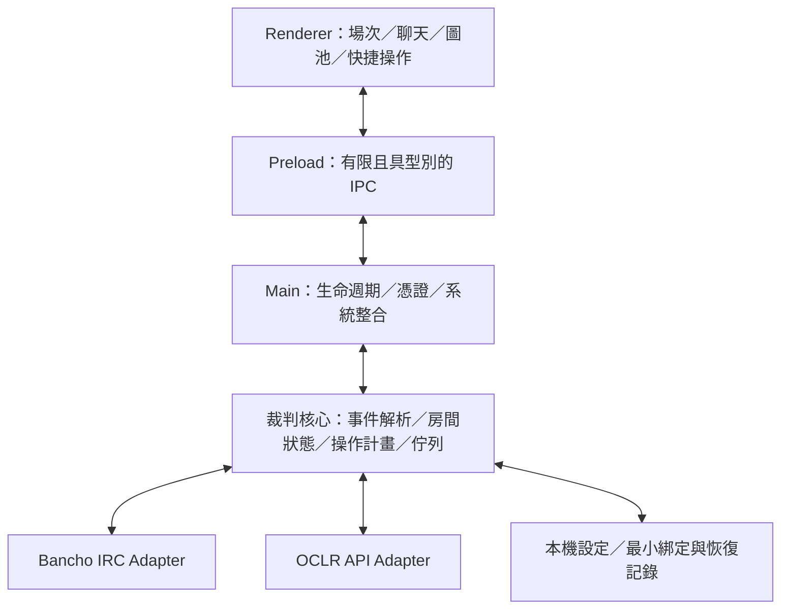

# OCLR-ref-tools 專案設計

- 文件版本：0.2（跨文件審查修訂）
- 日期：2026-10-27（Asia/Taipei）
- 狀態：設計草案，未開始實作
- 範圍：桌面客戶端、OCLR 整合及 MVP；不包含本輪部署、帳號授權或真實房間操作

## 1. 產品目標與使用流程

建立由裁判主導的 OCLR 工作台：選擇指派場次，取得正式規則、隊伍、圖池與工作人員資訊，準備及執行 Bancho IRC 指令，再依實際回覆確認房間狀態。

核心流程：

1. 登入 osu! IRC，另以系統瀏覽器完成 OCLR 授權。
2. 選擇本人負責場次，核對時間、隊伍、圖池與規則。
3. 綁定既有 MP 房間，或預覽房名與設定後建立房間。
4. 邀請隊員、安排槽位與隊伍、切圖及設定 Mods。
5. 由裁判執行計時、開始及必要的中止操作。
6. 保存操作記錄，複製 MP 連結並開啟 OCLR 審核頁。

MVP 暫以一名主控裁判、一個 IRC 帳號與單一目前操作場次為驗收範圍；IRC 仍可開啟多個頻道與私訊。多裁判操作鎖與跨裝置交接列為 P1。此範圍及產品政策尚待使用者確認，見 [設計決策](design-review.md)；待確認不影響保存或推送本設計草案，不視為已批准實作。

## 2. 查證基線與參考專案

### 2.1 外部能力

| 來源 | 已確認能力 | 設計採用方式 |
| --- | --- | --- |
| refsu | Tauri、Vue；房間狀態、快捷操作、圖池、禁圖標記與計時 | 參考房間工作流及圖池與指令的連動 |
| chat4osu | Electron、Angular；槽位與隊伍、地圖與 Mods、通知、聊天記錄、快捷鍵、恢復頻道 | 參考 IRC 底座、鍵盤操作與裁判資訊密度 |
| osu! IRC | Bancho 僅部分支援 IRC；官方設定為 irc.ppy.sh:6667、SSL 關閉；使用專用 IRC 密碼 | 專用 Bancho Adapter；明確呈現傳輸與登入限制 |
| osu! OAuth | 授權碼交換使用 client_secret | secret 留在 OCLR 後端，桌面使用 OCLR 專用憑證 |

參考功能與互動方式；實作時選定現行受支援版本並鎖定依賴。若需複用第三方原始碼，另確認來源授權與標示要求。

### 2.2 OCLR 現況

查閱的 OCLR-website 提交為 `d34378ef7b9a300a2baf1aaf61ff92c77a0b11e3`；refsu 提交為 `55e612b679eae86e252125e9bac10d710bafe3d3`。2026-10-27 曾實際讀取 OCLR 公開 `/api/v1/site`。其他後端能力以下以原始碼與文件為依據，未以真實裁判帳號驗證。

| 既有項目 | 可沿用內容 | 本方案待新增內容 |
| --- | --- | --- |
| `/api/v1` 與 OpenAPI | 版本化公開／私人讀取資料、錯誤及投影慣例 | 專用桌面授權與本人指派場次 API |
| Developer token | 開發期 Adapter 驗證 | 正式客戶端不要求 Developer grant |
| osu! OAuth | `identify`、驗證身分後建立網站 session | 桌面授權延續流程與獨立桌面 session |
| `fixtureForReview` | 場次、規則、正式隊伍、圖池、賽果狀態與指派驗證 | 裁判 context 投影、完整操作設定與修訂識別 |
| Streaming workspace | 直播指派及改期後的確認狀態 | 只提供本場裁判所需的直播資訊 |
| MP 匯入及審核 | 匯入、逐圖審核、Admin 核准及發布 | MVP 提供審核頁入口；P1 再整合寫入 |

Developer token 最長一小時，綁定原始網站 session、Developer grant 與 read scopes；它不是正式裁判客戶端的授權方案。既有 `/api/v1` 保持 read-only 語意，新功能使用獨立路徑。

## 3. 功能優先級

| 功能 | P0：MVP | P1 | P2 |
| --- | --- | --- | --- |
| IRC | 登入、頻道、私訊、補完、歷史、連結、未讀與提及 | 更多通知與搜尋設定 | 其他聊天傳輸 Adapter |
| 可靠性 | 心跳、錯誤分類、退避重連、狀態重取 | 診斷工具 | 進階回放分析 |
| OCLR | 桌面授權、我的場次、context、更新提示 | SSE、交接同步 | 跨賽事擴充 |
| 房間 | 開房／綁定、房名、模式、槽位、鎖房、密碼與裁判資訊 | 進階管理及遠端房間綁定 | 批次工作流 |
| 隊員 | 名單對照、邀請、分隊、槽位移動、缺席提示 | 換人流程與交接摘要 | 規則化流程助手 |
| 圖池 | 槽位代號、選圖、Mods／FM、設定差異 | Pick／Ban、擲骰與選邊、TB 與已打標記 | 自訂選圖流程 |
| 控制 | 計時、開始倒數、取消倒數、中止、重新同步 | 熱身／選圖／暫停階段及公告模板 | 進階規則引擎 |
| 快捷鍵 | 應用內快捷鍵、指令搜尋、常用訊息模板 | 複合模板 | 使用者擴充 |
| 日誌 | 當次聊天、操作步驟與結果的記憶體記錄，使用者明確匯出 | 可選持久日誌、交接封包 | 診斷回放 |
| 賽果 | MP 連結及 OCLR 審核頁入口 | 匯入及提交審核 | 統計輔助 |
| 直播 | 本場直播員與確認狀態 | 房間交接、公告、OBS 輸出 | 更多轉播整合 |

P0 不自動發布正式賽果、不決定未知規則、不在重連時自動重播開始／開房指令。正式賽果仍由 OCLR 既有審核流程產生。

## 4. Electron 跨平台架構

建議技術基線：Electron、TypeScript、React、electron-vite；Zod 或等價工具進行執行期契約驗證；本機 SQLite 保存設定及最小恢復記錄，聊天與操作日誌預設只在記憶體。具體依賴版本及 SQLite driver 在技術驗證階段決定，避免提前承諾未驗證的原生模組組合。

裁判核心是 Main 管理的邏輯模組，MVP 不要求額外 Utility Process；大量解析或匯出需要時再搬移。核心純資料邏輯與 Electron、網路、資料庫隔離，方便以合成事件驗證。Renderer 僅保存顯示狀態，權威房間狀態與佇列只有一份。

### 4.1 模組責任

| 模組 | 責任與限制 |
| --- | --- |
| Desktop shell | 視窗、選單、通知、縮放、系統瀏覽器、loopback callback |
| Identity service | IRC 與 OCLR 登入狀態分開；秘密只在 Main 及必要網路模組使用 |
| IRC transport | 行緩衝、編碼、心跳、連線生命週期、節流 |
| Bancho parser | 只將可信 BanchoBot／伺服器事件用於狀態；保留未知事件供診斷 |
| Lobby state | 槽位、隊伍、地圖、Mods、比賽階段與觀測時間；允許 unknown |
| Command planner | 將核准規則與意圖轉為固定房間的操作步驟 |
| Command queue | 依賴、序列化、逾時、結果核對與停止；不承諾 IRC exactly-once |
| Manual command gateway | 手動輸入、快捷鍵與 OCLR 意圖共用同一送出佇列；明確區分手動與 OCLR 已檢查操作 |
| OCLR adapter | 授權、契約驗證、完整快照替換、同步、錯誤碼與撤權 |
| Persistence | migration、設定、公開中繼資料、按帳號隔離的最小綁定／恢復記錄；不自動保存私人聊天或 context |

### 4.2 安全與儲存

- Renderer 使用 `nodeIntegration: false`、context isolation、sandbox 與 CSP。
- Preload 只公開具體操作；Main 驗證 IPC sender 與輸入，不提供任意檔案、URL、shell 或 IPC 代理。
- IRC 訊息、隊名、地圖名以文字顯示；連結僅允許核准協定並經系統瀏覽器開啟。
- OCLR access／refresh token 在 P0 僅存記憶體，App 重啟後重新授權。
- IRC 密碼的「記住」由使用者選擇；使用系統保護的儲存方式。Linux 無安全儲存時不落盤。
- 私人 context、聊天與完整操作日誌只存記憶體；IRC 聊天也可能包含未公開地圖及隊員，不能因來源是 IRC 就當作公開資料。公開中繼資料可保存。
- SQLite 最小恢復記錄僅含帳號 ID、edition slug、fixture ID、operation ID、動作種類、room ID（可 null）、pending／unknown／bound／closed 狀態及時間，不包含名單、隊名、圖池、指令 body 或秘密。開房送出前先保存 pending；重啟後的 pending／unknown 只能人工核對，不自動再開房。
- 最小記錄按帳號隔離，不能把另一帳號的綁定恢復到目前工作區；撤權／移除指派清除受影響場次記錄，登出清除此帳號記錄。非目前帳號、7 天未使用記錄於下次啟動清理。記錄不是遠端獨占或官方賽果證明。
- 使用者明確匯出可包含所選聊天與去密的操作內容，介面列明範圍；匯出檔可能含私人比賽資料，App 後續撤權不能追回已匯出檔案。自動診斷不得附帶聊天、context 或原始網路 body。
- 所有記憶體記錄及匯出均先遮蔽 PASS、token、code、verifier 與房間密碼，不因「僅記憶體」略過遮蔽。記錄保留政策為待確認決策 D06。

### 4.3 一致介面與發行

主畫面：左欄為場次／頻道／私訊，中央為房間聊天與控制，右欄為隊員／圖池／規則／直播。頂部顯示兩種登入、目前目標房間及資料新鮮度，操作佇列顯示步驟結果。

三平台共用元件、字型、樣式 token、資訊順序與操作語意；視窗按鈕、檔案對話框及 Cmd／Ctrl 遵循系統慣例。快捷鍵預設只在 App 內有效，避開中文輸入法組字與輸入欄位。

首版發行矩陣為 Windows x64（NSIS）、macOS arm64／x64（DMG＋ZIP）、Linux x64（AppImage）。原生依賴、簽章及公證由對應平台 CI 驗證；納入 electron-builder／electron-updater 評估。比賽中可提示更新，安裝與重啟延後至使用者結束操作。

## 5. 三種身分與資料權威

| 系統 | 能證明／決定的內容 | 無法替代的內容 |
| --- | --- | --- |
| osu! IRC | 已登入的 IRC 暱稱；Bancho 實際允許的房間操作 | OCLR 場次指派與資料權限 |
| osu! OAuth | osu! ID 及已授權 API 身分 | IRC 密碼與房間 referee 權限 |
| OCLR | 正式隊伍、規則、圖池、指派、直播與核准賽果 | Bancho 當前房間狀態 |
| 本機工作台 | 操作計畫、Pick／Ban 筆記、暫記比分、操作紀錄 | 官方賽果及遠端操作鎖 |

OCLR 身分與 IRC 帳號不一致時，停用全部 OCLR 衍生變更操作。暫定 P0 的 identity_match 是「IRC 登入成功的暱稱與當次 OCLR 登入名稱，依同一已驗證規則正規化後相符，且裁判核對帳號」；狀態使用 nickname_matched／mismatched／unavailable，不能標成 UID 已驗證。暱稱相符不是跨系統 UID 證明，亦不增加 API 權限；改名／名稱過時時重新登入核對，無法比對則保留手動 IRC。是否接受此 P0 門檻，或要求另有可靠 UID 證明才放行，列為 D05；SPIKE-01 回報可用證據，不能把尚未存在的 UID 查詢服務當成已完成依賴。Bancho 房間授權仍以實際回覆為準。

IRC 官方設定為 `irc.ppy.sh:6667`、SSL 關閉；帳號空格轉底線，使用 osu! 帳號設定頁的 IRC 專用密碼。此傳輸限制應在首次設定時清楚告知；尚未驗證的 TLS 連接埠或代理不作為預設。

## 6. 操作計畫與故障語意

一項操作至少包含：operation ID、意圖、fixture ID、固定 room ID、context revision、建立時間、前置條件、依序步驟與每步的預期回覆。開房沒有 room ID 時，以專用開房流程等待 BanchoBot 回傳實際 ID，再建立綁定。

步驟狀態：`queued → sending → awaiting_confirmation → succeeded`；另有 `failed`、`cancelled`、`unknown`。程式只能在已確認且前置條件仍成立時送出下一步。網路寫入成功不等於 Bancho 接受。

| 意圖 | 指令方向 | 核對重點 |
| --- | --- | --- |
| 開房 | 向 BanchoBot 傳送 `!mp make` | 實際房間 ID；逾時不自動再開一次 |
| 初始化 | `!mp set`、必要的 password／lock／addref | 只套用已明確設定且有權執行的項目 |
| 邀請／排位 | invite、move、team；優先使用官方支援的 `#<userid>` | 邀請成功與真正到場分開；Red／Blue 對照須明確 |
| 切圖 | map、mods、settings | 使用 beatmap ID；整組 Mods 符合規則，不能只累加 |
| 開始／計時 | start、timer、aborttimer | 開始倒數與一般計時分開；顯示實際事件 |
| 中止／關房 | abort、close | 明確顯示目標與影響，再由裁判確認 |

Bancho 無交易／冪等保證。重連後暫停未完成操作，以 settings／listrefs 等重新取得可觀測狀態；開始、中止、開房及倒數等不因超時自動重送。已執行步驟不假裝回滾。更換 UI 分頁不能改變已排定操作的目的地。

OCLR context 更新時作廢未送出的舊計畫；已在執行的計畫完成目前在途步驟後停止，重新核對。Start 前需具有 30 秒內成功取得的 context、足夠新鮮的 Bancho 設定及有效身分／權限檢查。遠端資料與 IRC 執行之間無法提供跨系統原子性，介面必須保留這個限制。

前置檢查按意圖定義：開房沒有既有 room_permission；Head To Head 不需要隊伍顏色；FM 人工檢查只在目前地圖政策要求時出現。context API 使用逐意圖 requiredLocalChecks，並由客戶端固定的最小檢查集合補強，伺服器不能透過少列條件略過本地保護。

OCLR 衍生變更操作在派送前都需未過期 context；預定義的設定、分隊與選圖可使用 freshUntil 內快照，create_lobby／start_game 每次明確執行前另成功重讀一次，不受背景輪詢的最小間隔限制。網路失敗或重讀後版本改變，回到預覽；所有目前在途步驟觀測可完成，但不再派送下一步。

所有房間變更（包含手動 !mp）共用每房間單一在途操作與全連線節流；未知手動指令不能繞過佇列。裁判要手動改變目前受操作的房間時，先停止後續計畫；應急 aborttimer／abort 可在停止後進入高優先序，但不回滾或重送在途指令。傳出文字、使用者自己的 echo 及聊天內聲稱的 BanchoBot 都不是確認事件。

Main 為登入、連線及目前場次維護 generation。登出、重登入、切換帳號／場次或換 IRC 連線後，忽略舊 generation 的 API 回應及未送出計畫；舊伺服器回覆可記為觀測，不能還原已清除的私人資料。session revoke 無法收回已被 Bancho 接受的指令或倒數，需明確保留手動應急路徑。

OCLR 暫時不可用時，裁判仍可切換明確標示的手動 IRC 控制，依 Bancho 實際權限取消倒數或中止；這些應急操作不依賴 OCLR 在線，也不能被顯示成已通過 OCLR 規則檢查。

## 7. MVP 邊界與依賴

P0 包含桌面授權、本人場次、context、開房／綁定、基本房間管理、隊員與圖池操作、可靠佇列、日誌與三平台驗收。獨立 IRC 手動模式可先完成；只有連接真實授權與正式契約後才算完成 OCLR 整合。

P1 包含多主控協調、遠端房間綁定、Pick／Ban、SSE、OBS 與賽果寫入。直播員不是因其工作人員身分就自動加入 Bancho referee；需要明確邀請或獨立 Bancho referee 指派。

開發依賴先以 SPEC-00 建立待驗證假設，經 SPIKE-01／02 回報後才由 SPEC-01 定版；避免把尚需實測的契約視為前置結論。依賴包含 OCLR 後端授權及資料投影、規則完整性、Bancho 回覆、三平台環境與簽章。詳細工作拆分見 [MVP 任務](mvp-plan.md)，授權與資料契約見 [桌面授權](contracts/desktop-authorization.md)及 [context API](contracts/referee-context-api.md)。

## 8. 參考來源

- [osu! IRC 官方文件](https://osu.ppy.sh/wiki/en/Community/Internet_Relay_Chat)
- [osu! 賽事管理指令](https://osu.ppy.sh/wiki/en/osu%21_tournament_client/osu%21tourney/Tournament_management_commands)
- [osu! API／OAuth 官方文件](https://osu.ppy.sh/docs/index.html#authentication)
- [refsu 指定提交](https://github.com/V1laZ/refsu/tree/55e612b679eae86e252125e9bac10d710bafe3d3)
- [chat4osu 原始碼](https://gitlab.com/hallowatcher/chat4osu)、[作者功能介紹](https://osu.ppy.sh/community/forums/topics/879262)
- [Electron 程序模型](https://www.electronjs.org/docs/latest/tutorial/process-model)、[安全](https://www.electronjs.org/docs/latest/tutorial/security)、[safeStorage](https://www.electronjs.org/docs/latest/api/safe-storage)
- [electron-vite](https://electron-vite.org/guide/)、[electron-builder 發行更新](https://www.electron.build/docs/features/auto-update/)
- [OCLR 讀取 API](https://github.com/OCLR-dev/OCLR-website/blob/d34378ef7b9a300a2baf1aaf61ff92c77a0b11e3/docs/read-api.md)、[Developer 授權](https://github.com/OCLR-dev/OCLR-website/blob/d34378ef7b9a300a2baf1aaf61ff92c77a0b11e3/docs/developer-api.md)
- [OCLR OAuth](https://github.com/OCLR-dev/OCLR-website/blob/d34378ef7b9a300a2baf1aaf61ff92c77a0b11e3/src/lib/auth/osu.ts)、[回呼](https://github.com/OCLR-dev/OCLR-website/blob/d34378ef7b9a300a2baf1aaf61ff92c77a0b11e3/src/app/auth/osu/callback/route.ts)
- [OCLR 場次資料](https://github.com/OCLR-dev/OCLR-website/blob/d34378ef7b9a300a2baf1aaf61ff92c77a0b11e3/src/lib/fixtures.ts)、[競賽流程](https://github.com/OCLR-dev/OCLR-website/blob/d34378ef7b9a300a2baf1aaf61ff92c77a0b11e3/docs/competition-operations.md)、[直播任務](https://github.com/OCLR-dev/OCLR-website/blob/d34378ef7b9a300a2baf1aaf61ff92c77a0b11e3/docs/streaming.md)
